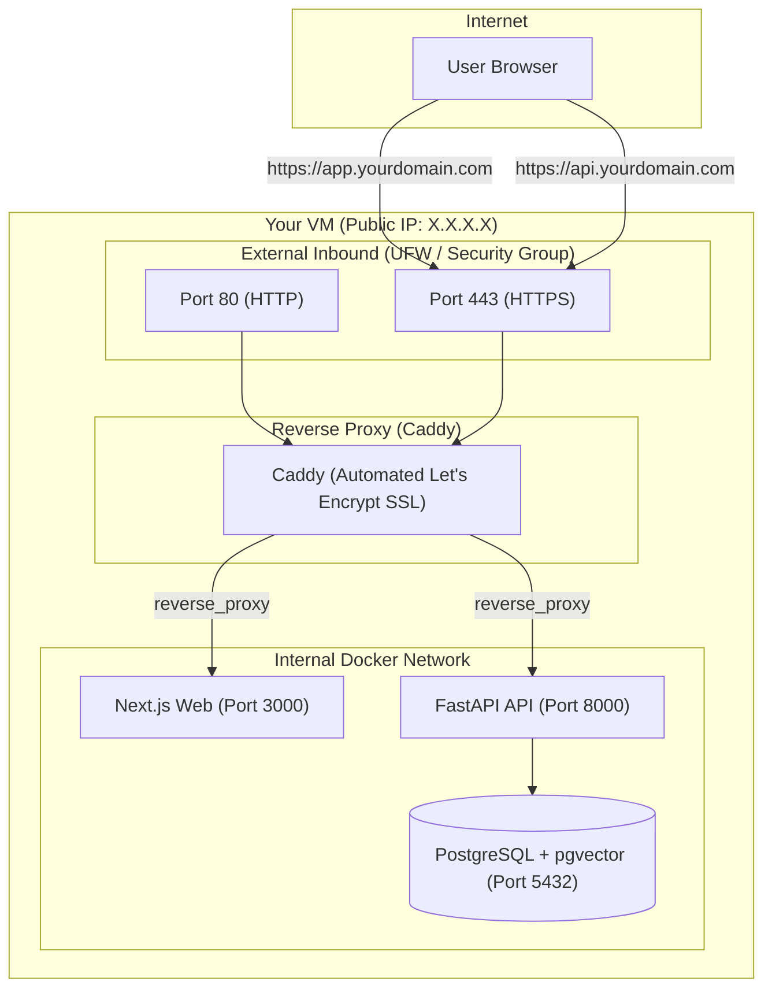

# Live VM Deployment Guide for NEXUS TITAN

This runbook guides you through deploying **NEXUS TITAN** live on your Ubuntu/Debian Virtual Machine (VM) with automated HTTPS on your custom domain via Caddy and Docker Compose.

---

## Architecture Overview



- **Domain Routing**:
  - `app.yourdomain.com` ➔ Next.js frontend UI (`web:3000`)
  - `api.yourdomain.com` ➔ FastAPI backend service (`api:8000`)
- **SSL Certificates**: Handled automatically by Caddy via Let's Encrypt (auto-issuance & auto-renewal).
- **Database**: PostgreSQL 17 with `pgvector` extension; data persisted in a Docker volume. Internal only; port 5432 is not exposed to the public internet for security.

---

## Step 1: Configure Your DNS Records

Log in to your DNS provider (Cloudflare, Namecheap, GoDaddy, Porkbun, Google Domains, etc.) and create two **A records** pointing to your VM's public IPv4 address:

| Type | Name / Host | Value / Target | TTL | Proxy Status (if Cloudflare) |
| :--- | :--- | :--- | :--- | :--- |
| **A** | `app` (or `app.yourdomain.com`) | `YOUR_VM_PUBLIC_IP` | Auto / 300s | **DNS only** (Grey Cloud)* |
| **A** | `api` (or `api.yourdomain.com`) | `YOUR_VM_PUBLIC_IP` | Auto / 300s | **DNS only** (Grey Cloud)* |

> [!NOTE]
> *If using Cloudflare, set the records to **DNS Only** (Grey Cloud) during initial certificate issuance so Caddy can solve the ACME HTTP-01 challenge directly.

Verify DNS propagation from your computer:
```bash
nslookup app.yourdomain.com
nslookup api.yourdomain.com
```

---

## Step 2: Open VM Firewall / Security Group Ports

In your cloud provider console (AWS EC2 Security Group, DigitalOcean Firewall, Hetzner, GCP Firewall, etc.), verify inbound firewall rules allow:
- **Port 22 (TCP)**: SSH access
- **Port 80 (TCP)**: HTTP (required by Let's Encrypt ACME challenge)
- **Port 443 (TCP & UDP)**: HTTPS & HTTP/3 QUIC

---

## Step 3: Connect to Your VM & Clone the Project

SSH into your VM:
```bash
ssh user@YOUR_VM_PUBLIC_IP
```

Clone your repository (or transfer files):
```bash
git clone <YOUR_GIT_REPO_URL> nexus-titan
cd nexus-titan
```

---

## Step 4: Configure Production Environment (`.env.production`)

There is a single template: root `.env.example`. Copy it to an ignored production env file:
```bash
cp .env.example .env.production
```

Edit `.env.production` using `nano` or `vim`:
```bash
nano .env.production
```

Set the following variables (see the production section in `.env.example`):
```dotenv
APP_ENV=production

# Your domain names
DOMAIN_WEB=app.yourdomain.com
DOMAIN_API=api.yourdomain.com

# Your email for Let's Encrypt certificate renewal notices
ACME_EMAIL=your-email@yourdomain.com

# PostgreSQL credentials
POSTGRES_USER=nexus_admin
POSTGRES_PASSWORD=generate_a_strong_random_password_here
POSTGRES_DB=nexus_titan

# Public API URL called by web client
NEXT_PUBLIC_API_URL=https://api.yourdomain.com
NEXT_PUBLIC_INFERENCE_PROVIDER=fixture
```

Save and exit (`Ctrl + O`, then `Enter`, then `Ctrl + X` in nano).
`./scripts/deploy-vm.sh` can also seed `.env.production` from `.env.example` on first run.

---

## Step 5: Run Automated Deployment

Make the deployment script executable and run it:
```bash
chmod +x scripts/deploy-vm.sh
./scripts/deploy-vm.sh
```

### What this script does automatically:
1. Detects and installs Docker & Docker Compose plugin if missing.
2. Configures UFW firewall (safely allowing ports 22, 80, 443).
3. Reads `.env.production` and validates domain names.
4. Builds the container images (`web`, `api`, `migrate`).
5. Launches PostgreSQL, runs schema migrations, starts FastAPI, Next.js, and Caddy.
6. Waits for API readiness probe and displays live URLs.

---

## Step 6: Verify Live Deployment

1. **Check API Health**:
   ```bash
   curl -i https://api.yourdomain.com/health
   # Expected response: {"status":"ok","service":"nexus-titan-api"}
   ```

2. **Check Database Readiness**:
   ```bash
   curl -i https://api.yourdomain.com/health/ready
   # Expected response: {"status":"ready","service":"nexus-titan-api"}
   ```

3. **Open the Web UI**:
   Open `https://app.yourdomain.com` in your web browser. You should see a valid SSL padlock and the live NEXUS TITAN Command Center.

---

## Useful Operational Commands

### View Service Status
```bash
docker compose -f docker-compose.prod.yml ps
```

### View Live Logs
```bash
# All services
docker compose -f docker-compose.prod.yml logs -f

# Specific service (e.g. Caddy SSL or API)
docker compose -f docker-compose.prod.yml logs -f caddy
docker compose -f docker-compose.prod.yml logs -f api
docker compose -f docker-compose.prod.yml logs -f web
```

### Restart or Redeploy
```bash
# Restart without rebuild
docker compose -f docker-compose.prod.yml restart

# Pull latest code and redeploy
git pull
./scripts/deploy-vm.sh
```

### Database Backup & Restore
```bash
# Create a backup
docker compose -f docker-compose.prod.yml exec postgres pg_dump -U nexus_admin nexus_titan > backup_$(date +%F).sql

# Restore a backup
docker compose -f docker-compose.prod.yml exec -T postgres psql -U nexus_admin nexus_titan < backup_YYYY-MM-DD.sql
```
