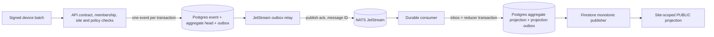

# ADR-0013: Tenant-sequenced event store and derived projections

- **Status:** Accepted provisionally (2026-11-15); runtime integration gate open
- **Context:** Phase 05 requires canonical Postgres writes with idempotency, optimistic conflict checks, transactional publication, replayable asset/incident state, and safe tenant/site Firestore projections. `prompts/reference/*` is absent, so aggregate domain rules remain provisional.
- **Contract:** `contracts/schemas/v1.1.0/contracts.schema.json` adds a signed `SyncEventBatch`, `site_id`, `aggregate_type`, `aggregate_id`, `expected_revision`, and typed per-event results. Readers retain v1.0.0 event compatibility. API/OpenAPI and TypeScript/Swift/Kotlin/Python bindings are generated from v1.1.0. Migration impact is additive; existing rows remain in sequence order and `last_sequence` is backfilled from existing events.
- **Decision:** Postgres `tenants.last_sequence` is locked with `SELECT ... FOR UPDATE`, serializing tenant appends. Each event must use the next tenant sequence and current aggregate revision. The event ID scope is `(tenant_id,event_id)`; a canonical payload SHA-256 distinguishes a safe replay from event-ID reuse. Each event has its own transaction containing event row, aggregate head, sequence head, and outbox row. Batch events are intentionally partial-commit, with per-event accepted/duplicate/conflict/denied outcomes.
- **Policy:** Sync requires a verified user, active tenant membership, active device registration and a P-256 signature over exact request bytes. Device source, aggregate type, event action, role, tenant/site scope, classification and bounded body size are checked server-side. Viewer writes and non-public/internal classification are denied. Client role claims do not authorize writes.
- **Delivery:** The outbox relay publishes with JetStream publish acknowledgments and `Nats-Msg-Id`. Publish is at least once; crash after broker ack can replay safely. A durable consumer writes a Postgres inbox key `(consumer,tenant,event)` and applies a deterministic reducer in one transaction before acknowledging. Firestore publication is a second Postgres outbox. Its Admin SDK transaction only applies newer sequence/revision state; only PUBLIC aggregate state is stored. INTERNAL and stricter states remove any earlier public document. Reconciliation replays the event log by sequence and rebuilds one explicitly confirmed tenant's Postgres and Firestore projection, returning a deterministic checksum.
- **Reducer baseline:** Asset/incident payloads are provisional JSON patches: create establishes state, update shallow-merges, delete tombstones, and deleted state cannot be silently resurrected. Classification only moves to more restrictive values. Replace these conventions if restored product references define different domain events.
- **Operational consequences:** Migration `002_event_store_sync.sql` adds event metadata, aggregate heads/projections, outbox retry fields, consumer inbox, dead letters and Firestore projection outbox. It backfills tenant sequence from current event rows. There is no destructive rollback; rollback is forward-only after backup. Firestore and NATS are derived; neither is a write authority. Rebuild deletes/replaces only docs under the explicitly selected tenant path and does not delete canonical events.
- **Verification boundary:** Unit/route/reducer checks do not prove Postgres concurrency, NATS JetStream, or Firestore transaction behavior. Live integration is required before marking this phase PASS.

