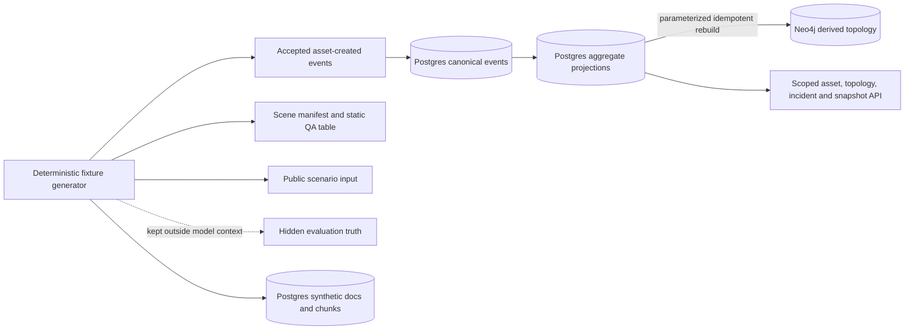

# ADR-0014: Synthetic asset ontology and derived graph

- **Status:** Accepted provisionally for fixture QA (2026-11-15); review against the missing master spec is still required
- **Context:** Phase 06 requires an internally consistent synthetic water-treatment world, event-backed asset APIs, graph projection, document metadata, and scene identity. No real plant data, operating guidance, or master ontology was supplied.
- **Decision:** `TITAN-WTP-01` is generated deterministically from seed `20261115`; the fixture is explicitly fictional and CC0-1.0. Asset IDs are stable under the fixture namespace. Directed dependencies, illustrative capacity constraints, and a local metre coordinate frame are assumptions for tests only. Public fixture facts are kept separate from pump-degradation evaluation truth.
- **Canonical ownership:** PostgreSQL accepted events and aggregate projections own fixture state. Migration `003_world_ontology.sql` stores seed hashes and original synthetic manuals/chunks with tenant/site foreign keys and optional vector values. Neo4j is a disposable derived view, rebuilt from accepted PostgreSQL projections. Firestore remains a separate derived security projection from ADR-0013. No graph or vector store is authoritative.
- **Graph projection:** Neo4j uniqueness key is `(tenant_id,site_id,asset_id)`. A fixed relation-label allowlist is mapped to parameterized `UNWIND`/`MERGE` statements. Rebuilds are scoped to a confirmed local tenant/site and versioned from canonical projected assets/relations. No manual contents or inspection evidence are copied into graph properties.
- **Scene contract:** Scene entities reference stable asset IDs and procedural geometry URIs. Positions use `TITAN_LOCAL_PLANT_GRID_V1`, metres, x-east/y-north/z-up. This does not assert a geodetic origin or real survey.
- **Consequences:** Contract additions are in new schema v1.2.0; v1.0.0/v1.1.0 remain unchanged. Migration 003 is additive; it adds a fixture-seed ledger, original document metadata/content, and chunks with an unspecified-dimension `vector` column. There is no vector index or retrieval behavior because the embedding model/dimensions are not chosen. Rebuilds can be repeated without changing canonical events; simulation-run reset deletes only one locally generated bundle after exact UUID confirmation.
- **Verification boundary:** Generator determinism/count/ID/topology/scene/schema tests and unit-level parameterization checks do not prove Postgres seed idempotence or a real Neo4j rebuild/query. Live service acceptance remains open until those integration tests run.

