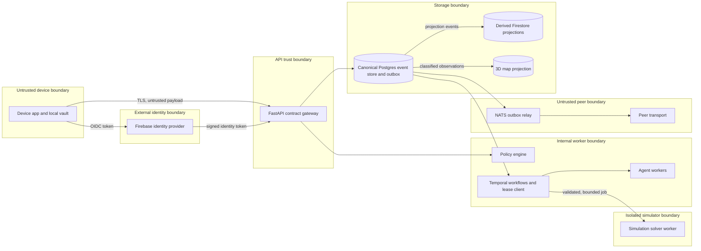

# NEXUS TITAN architecture baseline

**Status:** Provisional design baseline with Phase 05 event synchronization implemented in source. The referenced master specification was not supplied; decisions below are explicit assumptions from the phase briefs and must be reconciled when it is restored. Live database/broker/cloud integration remains unverified.

## Context and trust boundaries

Device, peer, simulator input, and Firebase claims are untrusted until authenticated, schema-validated, tenant-authorized, and policy-checked. Internal workers use separate service identities and least privilege. Firebase verifies identity; the API remains responsible for tenant authorization. Peer messages never select the receiving tenant from untrusted content.

## Ownership and data flow

| Data | System of record | Derived copies / owner | Rule |
|---|---|---|---|
| Versioned events and outbox rows | Postgres, owned by tenant | NATS delivery and downstream projections | Append-only; unique `(tenant_id,event_id)` and tenant-scoped sequence; transactional outbox |
| User identity | Firebase identity provider | API verified subject/tenant context | Body `tenant_id` never grants authority; verified claims are mapped to memberships |
| Search/read projections | Postgres event log | Firestore, owned by projection service | Rebuildable and disposable; no canonical writes from clients |
| Synthetic world state | Accepted Postgres asset/incident events | Postgres aggregate projections; Neo4j graph and scene manifest are derived | Fixture only; Neo4j receives allowlisted asset properties, no manual/evidence content |
| Synthetic document chunks and citations | Postgres `knowledge_document_versions`, `knowledge_chunks`, and `knowledge_embeddings` (fixture vectors only); legacy source copy remains in `world_documents` | Tenant/site scoped lexical + pgvector retrieval and evidence citations; Neo4j remains the derived asset graph | Current-version/revocation/classification predicates; stable offsets/hashes; restricted source ingestion denied |
| Device credentials | Local OS vault, owned by device/user | None by default | Store opaque refresh material only when required; never send vault contents to API |
| 3D map state | Source observations in Postgres | Versioned spatial projection | Carry coordinate frame, units, classification, tenant and provenance |
| Simulation result | Request/input in Postgres | Solver artifact store and projections | Bounded worker execution; result references immutable input/schema versions |

## Schema and API error policy

Contracts are immutable under `contracts/schemas/v1.0.0/` through `v1.3.0/`. Every persisted or exchanged event/task/result carries `schema_version`. Additive or optional changes receive a new minor schema directory and compatibility fixtures; breaking changes receive a new major version. A decoder validates against the declared version, does not coerce unknown enum values, and returns a structured contract error. Do not silently map unknown values to a default.

| Code | HTTP | Meaning |
|---|---:|---|
| `VALIDATION_ERROR` | 422 | Payload is invalid for its declared schema |
| `TENANT_SCOPE_VIOLATION` | 403 | Body or referenced resource crosses verified tenant scope |
| `POLICY_DENIED` | 403 | Policy engine denied the requested action |
| `CONFLICT` | 409 | Duplicate event/idempotency key or conflicting sequence |
| `NOT_FOUND` | 404 | Tenant-scoped resource does not exist |
| `NOT_IMPLEMENTED` | 501 | Adapter is deliberately not configured in this foundation |
| `INTERNAL_ERROR` | 500 | Unexpected failure; return only a request ID to clients |

The API validates generated JSON Schemas. Signed event sync persists canonical events, aggregate revisions and outbox rows in a single Postgres transaction; the JetStream consumer uses a durable inbox and a projection checkpoint. Simulation and agent requests still return explicit `NOT_IMPLEMENTED`; no persistence or inference is mocked. Database, NATS and Firestore runtime integration is not yet verified on this host.

## Module ports

`packages/contracts/src/ports.ts` declares typed `EventStore`, `Projection`, `PolicyEngine`, `InferenceAdapter`, `AgentExecutor`, `SimulationSolver`, `PeerTransport`, and `WorkflowLeaseClient` interfaces. Request/result types come from generated contracts. A role descriptor carries an input JSON Schema, output JSON Schema, and risk tier. Concrete roles are intentionally not enumerated until the master spec defines them.

## Migration and rollback outline

1. Add new tables/columns and indexes with forward-only, tenant-keyed migrations; do not rewrite event history in place.
2. Deploy readers that accept old and new versions, then dual-write only through the Postgres transaction plus outbox.
3. Backfill derived projections from the event cursor and compare tenant-scoped counts/checkpoints.
4. Switch readers after verification; keep prior projection generation available for rollback.
5. Remove old fields/versions only after consumers and retention policy permit it. Rollback application code first; roll back destructive schema only through a tested compensating migration.

Phase 05 adds forward-only `002_event_store_sync.sql`: tenant sequence heads, aggregate metadata/revisions, inbox, dead letters, projection state/checkpoints and retryable projection outbox columns. It backfills tenant heads and marks pre-v1.1 legacy events as already passed by the projection cursor. Phase 06 adds `003_world_ontology.sql`, tenant/site-scoped fixture seed ledger and synthetic document/chunk tables with optional pgvector embeddings. Existing event history is retained. Downgrade is intentionally not destructive; rollback is an application rollback or a reviewed compensating migration.

## Phase 02 hybrid inference note

Web hybrid inference is a client-side Firebase AI Logic spike (`/firebase-spike`) behind App Check. It is not an API adapter and does not write canonical events. See [ADR-0010](adr/0010-firebase-ai-logic-hybrid-spike.md) and [hybrid spike docs](firebase/hybrid-spike.md). Release still requires real Gate A/B/C evidence.
